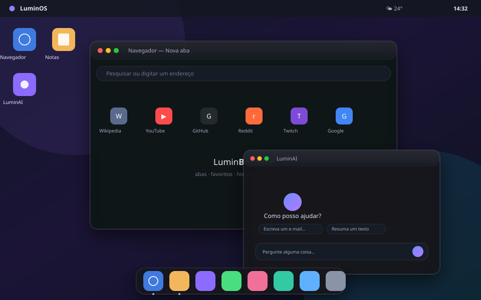

# LuminOS

**Um sistema operacional na web.** Minimalista, interativo e inteiramente local — janelas arrastáveis, navegador com abas, IA, jogos, música generativa, terminal e uma loja de apps. Sem instalação, sem conta, sem servidor, sem telemetria.

<p align="center">
  
</p>

---

## ✨ O que tem dentro

| App | O que faz |
| --- | --- |
| **LuminBrowser** | Abas, histórico, favoritos, motor de busca configurável e **modo proxy** para abrir sites que bloqueiam iframe |
| **Notas** | Editor com autosave, busca, fixar, exportar `.md` |
| **LuminAI** | Assistente offline (motor local) ou conectado a qualquer endpoint compatível com OpenAI/Ollama |
| **Jogos** | Serpente, Memória, Jogo da Velha (IA), 2048, Reflexo, Campo Minado, Simon |
| **Música** | Sequenciador generativo com Web Audio — 5 “faixas” infinitas |
| **Soundboard** | 16 pads sintetizados em tempo real (nada de arquivos de áudio) |
| **Paint** | Pincel, borracha, formas, exportar PNG, usar como papel de parede |
| **Editor de Código** | HTML/CSS/JS com pré-visualização ao vivo e salvamento |
| **Loja** | Instala/desinstala apps no desktop |
| **Arquivos** | Sistema de arquivos virtual persistente em `localStorage` |
| **Terminal** | Shell real com `ls`, `cd`, `cat`, `touch`, `mkdir`, `rm`, `neofetch`, `theme`, `open`… |
| **Chat** | Salas locais com mensagens persistentes e respostas simuladas |
| **Relógio / Calendário** | Analógico, cronômetro, fusos e eventos por dia |
| **Configurações** | Temas, cor de destaque, wallpapers, som, notificações, conta, atalhos, backup |
| **Fotos** | Galeria local com lightbox e “usar como papel de parede” |
| **Câmera** | Captura fotos (e vídeo de 5 s) via `getUserMedia`, direto no navegador |
| **Links** | Seus atalhos favoritos com categorias |
| **Sugestões** | Bloco de ideias com avaliação por estrelas |

## 🖥️ Recursos de sistema

- **Gerenciador de janelas** próprio: arrastar, redimensionar pelas 8 bordas, minimizar, maximizar e **snap** nas bordas (metade, cantos, tela cheia)
- **Dock** com indicador de apps abertos, **launcher** de apps, **command palette** (`Ctrl/Cmd + Space`) e **busca do desktop** (`Ctrl/Cmd + K`)
- **Barra superior** com menus por janela, clima, bateria, volume, notificações e calendário
- **Tela de bloqueio** com PIN opcional e introdução (onboarding) de primeiro uso
- **Central de notificações** com toasts
- **6 temas** (Escuro, Claro, Meia-noite, Nord, Areia, Vidro) + 7 cores de destaque + 8 papéis de parede (ou use uma imagem sua)
- **Sons do sistema** sintetizados (Web Audio), volume e “não perturbe”
- **Backup** exportável/importável em JSON
- **PWA**: instalável na tela inicial e com service worker (o sistema abre offline)
- **Tudo offline**: funciona sem internet (exceto as páginas que você abrir no navegador)

## ⌨️ Atalhos

| Atalho | Ação |
| --- | --- |
| `Ctrl/Cmd + K` | Busca de apps e arquivos |
| `Ctrl/Cmd + Space` | Command palette (ações) |
| `Alt + Tab` | Alternar janelas |
| `Ctrl/Cmd + W` / `M` | Fechar / minimizar janela |
| `Ctrl/Cmd + ,` | Configurações |
| `Ctrl/Cmd + T` / `L` | Nova aba / focar endereço (navegador) |
| `F11` | Tela cheia |

## 🚀 Rodar localmente

Não há build, dependências nem `node_modules`. Basta servir a pasta como arquivos estáticos:

```bash
# opção 1 — Python
python3 -m http.server 8080

# opção 2 — Node
npx serve .

# opção 3 — PHP
php -S localhost:8080
```

Depois abra <http://localhost:8080>.

> Abrir o `index.html` direto pelo `file://` **não** funciona: módulos ES exigem um servidor (http/https).

## ☁️ Publicar

- **GitHub Pages**: Settings → Pages → *Deploy from branch* → branch `main`, pasta `/` (o `index.html` está na raiz).
- **Netlify / Vercel / Cloudflare Pages**: basta apontar para o repositório, sem build command.
- **IPFS / qualquer CDN estática**: envie os arquivos.

Todos os caminhos são relativos — o app funciona em subpastas (`usuario.github.io/LuminOS/`).

## 🧱 Arquitetura

```
index.html            shell declarativa (boot, desktop, topbar, dock, painéis)
css/style.css         design system: tokens, temas, janelas, painéis
css/apps.css          superfícies internas de cada app
js/core.js            helpers (h(), storage, bus, sons, formatação)
js/icons.js           conjunto de ícones SVG + ícones de app
js/wm.js              gerenciador de janelas (drag, resize, snap, foco, switcher)
js/registry.js        registro central de apps + resolução de web apps
js/desktop.js         shell: topbar, dock, launcher, painéis, atalhos, temas
js/notifications.js   central de notificações
js/ui.js              toasts, modais, menus de contexto
js/main.js            bootstrap, onboarding, tela de bloqueio
js/apps/*.js          um módulo por aplicativo
sw.js                 service worker (cache-first) para uso offline
assets/               ícone e manifest (PWA)
```

**Contrato de um app** (adicionar um novo leva ~20 linhas):

```js
export const meuApp = {
  id: 'meuapp',
  name: 'Meu App',
  glyph: 'spark',                 // chave em js/icons.js
  grad: ['#8b6cff', '#e06be0'],   // gradiente do ícone
  size: { w: 600, h: 420 },
  category: 'Utilidades',
  dock: true, desktop: true, singleton: true,
  mount(body, api) {
    body.append(/* seu UI */);
    api.setTitle('Meu App');      // opcional
    api.addTool(/* botão */);     // opcional
    api.onArgs((args) => {});     // recebe openApp(id, { args })
    return { onClose() {}, args(a) {} };
  },
};
```

Registre em `js/registry.js` e pronto — aparece na dock, no launcher, na busca e na loja.

### Persistência

Tudo fica em `localStorage` com prefixo `luminos:`. Nada é enviado para servidores. Use **Configurações → Armazenamento** para exportar/importar um backup ou limpar tudo.

### Privacidade

- Nenhuma requisição de rede é feita pelo sistema (nem fontes externas: as fontes são do sistema).
- O navegador usa `iframe` + proxy opcional de CORS — respeitando as escolhas do site (alguns bloqueiam incorporação).
- A chave de API de IA, se você configurar, fica salva apenas no seu navegador e é enviada somente ao endpoint que você indicar.

## 🎨 Design

Interface enxuta: muito espaço em branco, tipografia do sistema, bordas de 1px, vidro fosco discreto, uma única cor de destaque e movimento contido. Tokens em `:root` tornam qualquer mudança de tema trivial — os 6 temas são só 6 blocos de variáveis.

## 📄 Licença

MIT. Use, fork, modifique e publique.
